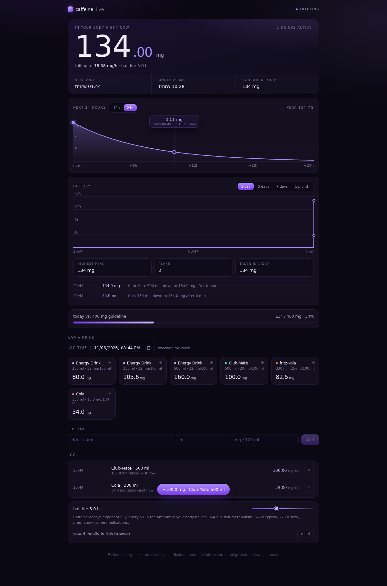

# caffeine

Real-time caffeine tracker. Tap a drink, watch the mg count in your body decay live.

**https://sametyildiz.dev/caffeine/**



## How it works

Caffeine follows first-order (exponential) elimination, so each dose decays on its own
from the moment it was logged:

```
A(t) = A0 * 0.5^(t / t_half)
```

- half-life is selectable, 3-8 h (default 5 h; 3-4 h fast metabolizer, 7-8 h slow /
  pregnancy / some medications)
- total in the body is the sum of every dose still decaying, recomputed every 50 ms
- the projection curve is the same formula sampled over 12 h or 24 h (picker in the
  card header); that same 12 h / 24 h setting switches every clock between AM/PM and
  24-hour time
- hover (or drag on touch) the curve to read the mg at any future time

## Move state between devices

Two ways, both client side:

- **json file** — `download json` writes `caffeine-YYYY-MM-DD.json`; `import json` reads it back
- **qr code** — `show qr` renders the same snapshot deflate-compressed as a QR; on the other
  device hit `scan qr` and point the camera at it. The decoder loads only when you scan.

Import **merges**: a drink already on the device (same name, size, mg and second) is not
added twice. A device with no drinks adopts the sender's half-life and 12 h / 24 h setting;
a device that already has drinks keeps its own.

A full 40-day history (~300 drinks) still fits in one QR; past that the card tells you to
use the file.

## No backend

Everything lives in `localStorage` under `caffeine-tracker-v1`. There is no server,
no API and no database: `serve.ts` is only a static file server for local play.
`dist/` is the whole app and can be dropped on any static host.

## Stack

Bun + Svelte 5, bundled with `Bun.build` and `bun-plugin-svelte` directly (no Vite).

## Development

```bash
bun install
bun run build     # -> dist/
bun run start     # http://localhost:8099
```

## Deploy

The site is assembled by the `sayildiz.github.io` repo: it checks out this repo,
builds `dist/`, and copies it into `_site/caffeine/`. Pushing to `main` here fires a
`repository_dispatch` (`caffeine-updated`) at the site repo, which rebuilds and
redeploys GitHub Pages.
